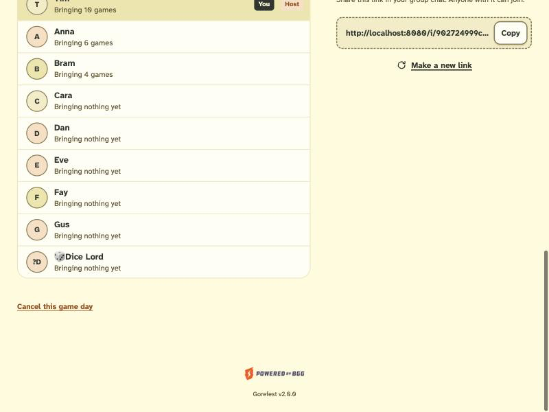

# BUG-003: A name that starts with an emoji shows "?" as its avatar initial

- **Severity:** minor
- **Area:** Components / avatars (shown on hub, home, readiness, table chips)
- **Environment:** desktop 800x600, light theme, host Tim looking at a player named "🎲 Dice Lord".

## Steps to reproduce
1. Log in as a new player, on `/welcome` enter the name `🎲 Dice Lord`.
2. Join any game day via its invite link (`POST /i/{token}/join`, or tap "Join").
3. As the host open the game day hub, scroll to "Players". Also visible on `/` (game day card avatars) and `/gamedays/{id}/ready`.

## Expected
The avatar shows a sensible initial (for example "D", or the whole emoji).

## Actual
The avatar shows `?D`: a lone UTF-16 surrogate half is rendered (replacement/`?` glyph) followed by "D". Reproduced on three pages. The bytes in the HTML are `3f 44` (`?D`).

## Evidence


```
<span class="gf-avatar" aria-hidden="true" data-hue="0">?D</span>
```

## Suspected cause (guess)
`web/components/Avatars.kt`, `initials()`: `it.first().uppercase()` takes a single UTF-16 `Char`, which splits surrogate pairs. Use `codePointAt`/`Character.toChars` or grapheme-aware first char.

## Status

Status: fixed. initials() takes whole code points and ignores words that start with a symbol, so "🎲 Dice Lord" shows "DL". (commit b1d4c99)
