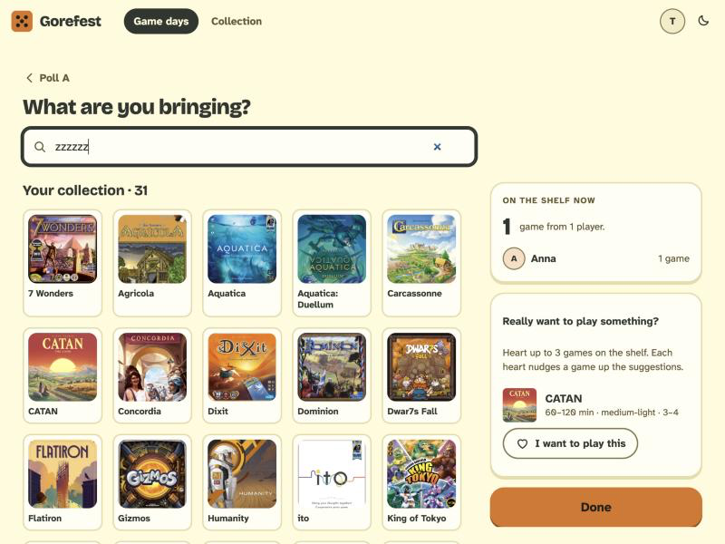

# BUG-004: Searching for a game that doesn't exist shows nothing at all

- **Severity:** minor
- **Area:** Bringing games (`/gamedays/{id}/bring`) and play log (`/gamedays/{id}/log`) search
- **Environment:** desktop 800x600, light theme, Tim (BGG linked as `timbgg`, fake BGG).

## Steps to reproduce
1. Log in as Tim, link BGG (`timbgg`), create a game day.
2. Open `/gamedays/{id}/bring`, click the search box ("Search your collection or BGG") and type `zzzzzz`.
3. Wait one second. Repeat with `a`.
4. Same on `/gamedays/{id}/log` (game day dated today): type `zzzzzz` in "Search BGG".

## Expected
A short empty state ("Nothing found for 'zzzzzz'. Try another spelling." in house voice), so the person knows the search ran.

## Actual
The results area stays empty; the collection grid just sits there as if nothing happened. The fragment is `<div class="gf-bring__results" id="search-results"></div>` (log: `<div id="log-search-results"></div>`).

## Evidence


```
GET /gamedays/{id}/bring/search?q=zzzzzz  ->  <div class="gf-bring__results" id="search-results"></div>
GET /gamedays/{id}/log/search?q=zzzzzz    ->  <div id="log-search-results"></div>
```

## Suspected cause (guess)
`ShelfViews.kt` `searchResults()` and `CheckpointViews.kt` `logSearchResults()` render nothing when `rows`/`games` is empty and `bggUnavailable` is false; there is no empty-state branch. The same function is used for the initial (empty) page, so the "no query yet" and "no match" cases need to be told apart.
