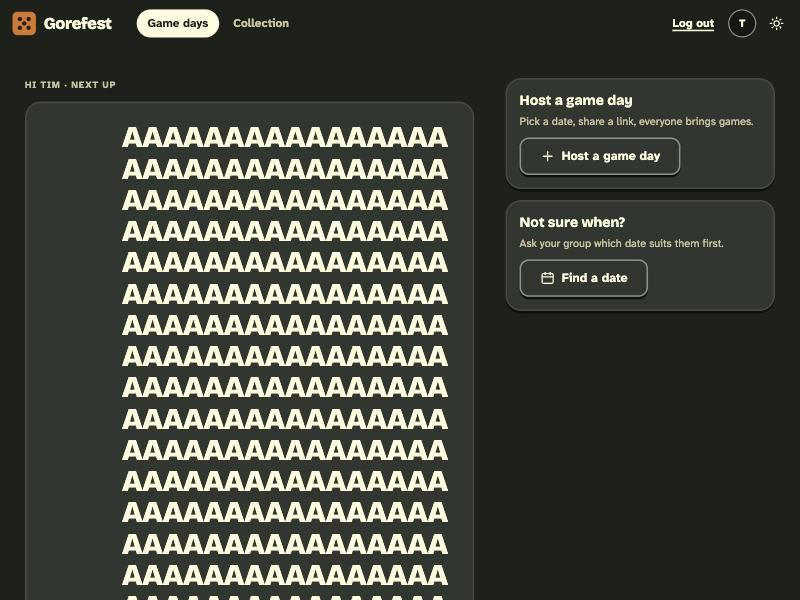
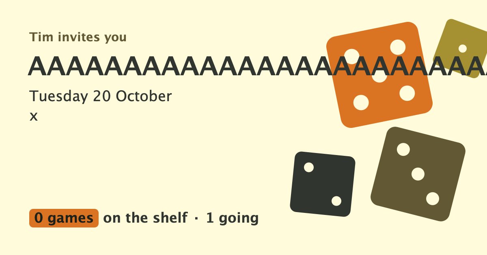

# BUG-006: Game day title and place have no length limit; a long word overflows the invite preview image

- **Severity:** minor
- **Area:** Game day creation / edit, home, invite Open Graph image
- **Environment:** desktop 800x600 dark; Tim as host. Mobile (375px) checked: the page itself wraps, no horizontal scroll.

## Steps to reproduce
1. Log in as Tim.
2. `POST /gamedays` (or the form) with `title` = 5000 times `A`, a future date and `place=x`. It is accepted (HTTP 204 + `HX-Redirect`).
3. Open `/` : the card title fills the whole screen with `AAAA...`.
4. Open the game day, copy the invite link and open `{invite}/og.png`.

## Expected
A sensible maximum (the welcome name already caps at 40) with an error in the form; the OG image never draws outside the canvas.

## Actual
- 5000-character title accepted and shown in full on home, hub, `<title>` and the shared preview.
- The 1200x630 OG image draws the single long word straight through the dice artwork and off the canvas.
- With a normal long title (60 chars with spaces) the OG image wraps to two lines and silently drops the rest (`Gorefest 7: the long awaited ...` becomes `Gorefest 7: the long awaited`) with no ellipsis, while the place gets an ellipsis.

## Evidence

## Suspected cause (guess)
`core/gameday/CreateGameDay.kt` / `EditGameDay.kt` only check `title.isBlank()`; no max length for title or place (same in `CreateDatePoll`). `invite/OgImage.kt` wraps on spaces only and does not clip title overflow/ellipsise the title like it does for the place.
