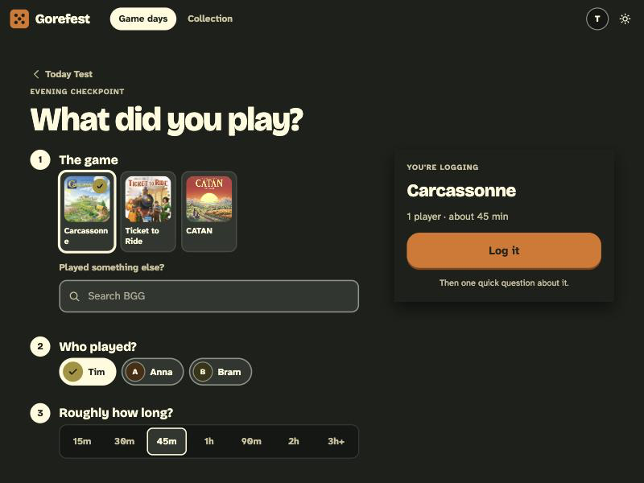
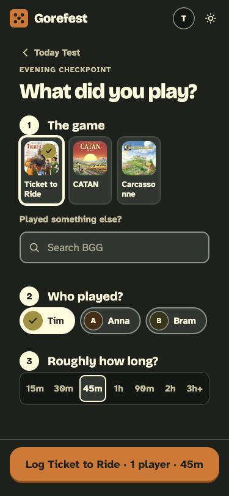

# BUG-008: Game names in tiles break in the middle of a word ("Carcassonn / e")

- **Severity:** cosmetic
- **Area:** Play log (`/gamedays/{id}/log`), tile component (`gf-tile__name`); likely other tile grids
- **Environment:** desktop 800x600 and mobile 375x812, light and dark theme, game day dated today with CATAN, Carcassonne, Ticket to Ride on the shelf.

## Steps to reproduce
1. Create a game day dated today, bring Carcassonne (and others).
2. Open `/gamedays/{id}/log` ("Log a game").
3. Look at the tile row under "1 The game".

## Expected
"Carcassonne" stays on one line (smaller font or ellipsis) or wraps between words only.

## Actual
The label wraps as `Carcassonn` / `e` on both desktop and phone.

## Evidence

## Suspected cause (guess)
`docs/design/css/gorefest.css` line ~118, `.gf-tile__name { ... overflow-wrap: anywhere; ... }` lets the browser break anywhere when the tile is narrow; tiles in the log are ~70px wide. `overflow-wrap: break-word` plus a slightly smaller font or wider min tile would avoid it.

## Status

Status: fixed. Tile names wrap with overflow-wrap: break-word and the log tiles use auto-fill columns of at least 108px, so "Carcassonne" fits on one line. (commit 552f702)
