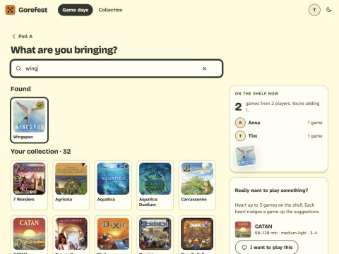

# BUG-009: "Your collection · N" counts games found by search that you do not own

- **Severity:** cosmetic
- **Area:** Bringing games (`/gamedays/{id}/bring`)
- **Environment:** desktop 800x600, light theme, Tim linked as `timbgg` (31 games).

## Steps to reproduce
1. As Tim (BGG linked, 31 games) open a game day's bring page: heading reads `Your collection · 31`.
2. Search `wing`, tap the Wingspan tile (bring it).
3. Clear the search field.

## Expected
The heading still says 31 (Tim's collection), or the extra game sits under a different heading ("Also bringing").

## Actual
Heading becomes `Your collection · 32`; Wingspan is mixed into the alphabetical collection grid.

## Evidence

## Suspected cause (guess)
`ShelfRoutes.kt` `bringList()` deliberately merges "anything I brought that isn't in it (found by search)" into the collection list; the view labels the merged list and its count as the collection.
