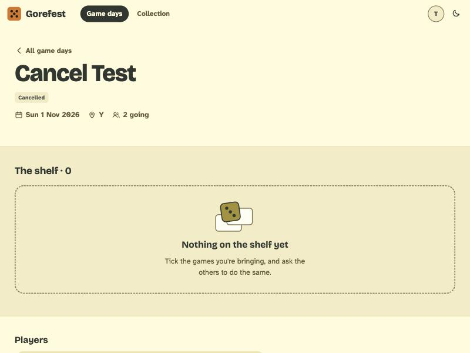

# BUG-012: A cancelled game day still tells you to "Tick the games you're bringing"

- **Severity:** cosmetic
- **Area:** Game day hub (empty shelf state on a cancelled game day)
- **Environment:** desktop 800x600, light theme, Tim (host) and Anna (member) both see it.

## Steps to reproduce
1. As Tim create a game day (any future date), have Anna join via the invite link.
2. As Tim open "Cancel this game day" and confirm (`POST /gamedays/{id}/cancel`).
3. Open `/gamedays/{id}` as Tim or Anna.

## Expected
The cancelled hub carries no calls to action; the empty shelf says nothing or "No games were brought."

## Actual
Header correctly shows "Cancelled", but the shelf section reads "Nothing on the shelf yet. Tick the games you're bringing, and ask the others to do the same." with no way to do so (the Bring link and `/bring` 404 on a cancelled day).

## Evidence

## Suspected cause (guess)
`GameDayViews.kt` shelf empty state is rendered regardless of `gameDay.cancelled`.
