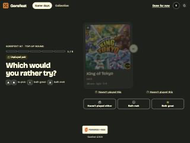

# BUG-014: After logging out, the Back button shows the previous user's pages

- **Severity:** minor (privacy on shared devices)
- **Area:** Auth / HTTP caching headers
- **Environment:** desktop 800x600, dark theme, Browser pane; Tim.

## Steps to reproduce
1. Log in as Tim and open `/gamedays/{id}/taste` (any member page works).
2. Log out (`POST /logout`, then you land on `/login`).
3. Press the browser Back button.

## Expected
Back leads to the sign-in page (or a re-fetch that redirects to `/login`); personal pages are not shown to the next person at the keyboard.

## Actual
The full authenticated page (Tim's avatar "T", the taste-round pair, "Done for now") is restored from the browser's history cache. Navigating to `/` afterwards correctly redirects to `/login`, so the session really is gone; only the cached copy remains.

## Evidence


```
curl -i -b tim.jar localhost:8099/   ->  200 OK, headers: X-Robots-Tag, Content-Length, Content-Type  (no Cache-Control)
```
Reproduced once in the browser; the missing header was checked on several authenticated pages.

## Suspected cause (guess)
Authenticated HTML responses carry no `Cache-Control: no-store` (or `private, no-cache`); `NoIndex` plugin only sets `X-Robots-Tag`. Setting it for responses behind `authenticated {}` (and on `/logout`'s redirect target) would stop bfcache/history reuse.
